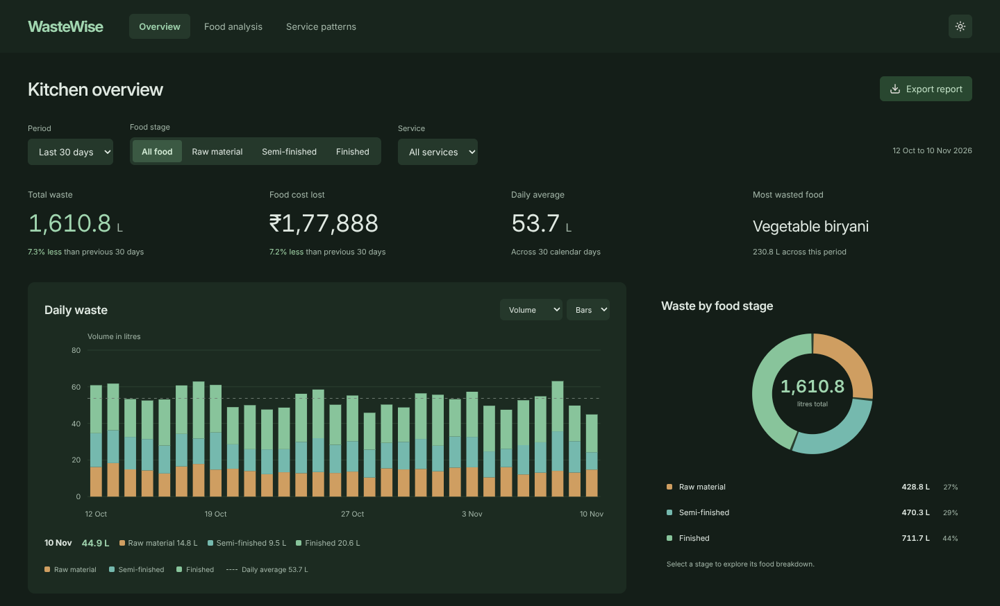
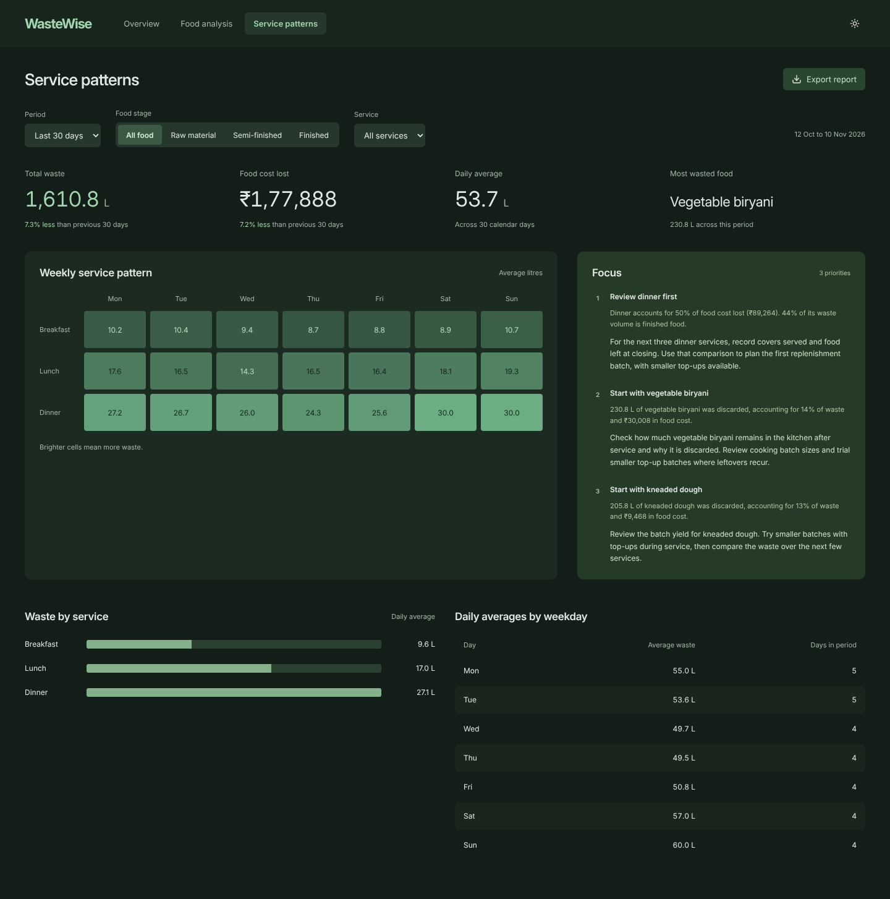

# WasteWise dashboard

**See the [WasteWise](https://github.com/arjun-maker-portfolio/wastewise) repository first.**
A dashboard for restaurant owners and kitchen managers to inspect waste measured automatically by the WasteWise camera system.

## Data

This repository contains a reduced version of the WasteWise dashboard with fixed sample records and example ingredient costs in `data/demo.json`.

In the full system, a camera connected to a Raspberry Pi identifies food discarded during kitchen preparation and cooking. The waste measurements are stored in a database and feed into the dashboard. This public demonstration reads the bundled file instead.

Breakfast, lunch and dinner refer to the meal period the kitchen is preparing for. Filters update the reports, and CSV export follows the current selection.

## Focus

Focus highlights foods with high waste costs or a large share of discarded volume. It also checks for increased daily waste and weekday patterns that recur across multiple weeks.

The rules rank up to three priorities for the current filters. Each recommendation shows the figures behind it and suggests a kitchen practice to review, such as stock rotation or cooking batch size.
